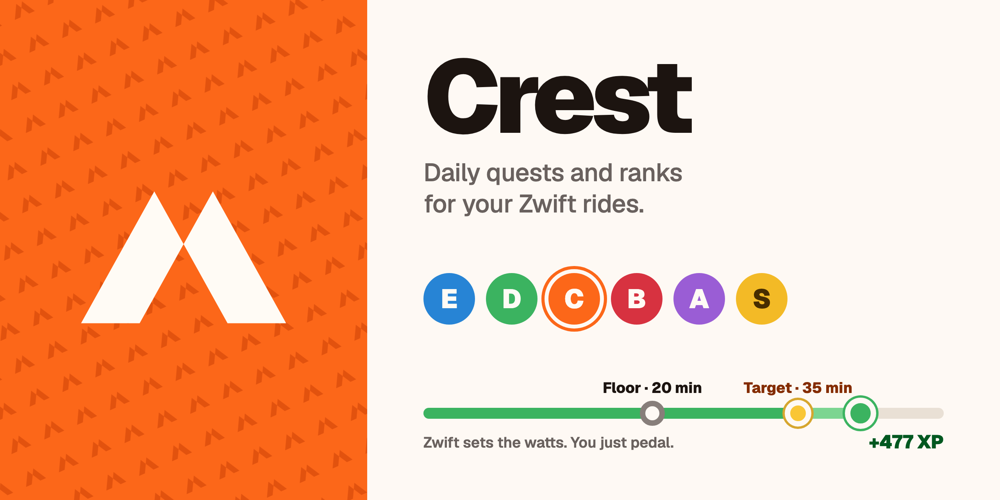

<a href="https://github.com/abdullahridwan/crest-releases/releases/latest"><b>Download the latest version</b></a> · macOS 11 or later · Apple Silicon and Intel · Free

# Crest

Crest turns your Zwift rides into a daily quest, XP and a rank. It reads the rides Zwift already saves on your Mac, so there's nothing to connect and no account to make.

- **One quest a day.** Every quest has a **floor** and a **target**. Ride the floor to keep your streak. Every minute after it earns more XP, up to the target and beyond.
- **Zwift does the work.** Accept a quest and it appears in Zwift under Workouts, then Custom Workouts. Zwift sets the watts for every block, so you just pedal.
- **Ranks E to S.** Rookie, Rider, Contender, Challenger, Elite, Legend. Each rank has its own XP bar.
- **Streaks multiply XP.** 1.25× from day 3, 1.5× from day 7. Miss a floor and it starts over.
- **History.** A calendar of every ride, with the XP breakdown for each day.

## Install

1. Download the `.dmg` from the [latest release](https://github.com/abdullahridwan/crest-releases/releases/latest).
2. Open it and drag **Crest** into **Applications**.
3. The first time, right-click Crest and choose **Open**. Crest isn't notarized by Apple yet, so macOS asks you to confirm once.
4. When Crest asks to open your Documents folder, choose **Allow**. That's where Zwift saves your rides.

## Privacy

Crest only reads `Documents/Zwift/Activities` and writes one workout file to Zwift's Custom Workouts folder. Nothing leaves your Mac.
